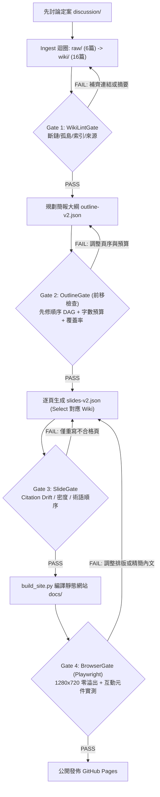

# Context Engineering（上下文工程）— LLM Wiki 與可驗證教學 HTML 簡報

本專案為 **「用 LLM Wiki 做一份教學 HTML 簡報」** 之完整實作成果。依據 Andrej Karpathy 提出的 **LLM Wiki 三層架構**與「**先討論、後生成**」原則，從 6 篇一手論文與工程實戰文獻編譯出 16 篇彼此互連的知識頁，並透過「前移檢查狀態圖（Shift-Left Verification Graph）」產出適合零基礎初學者的 14 頁互動式教學簡報。

---

## 🌐 公開瀏覽連結（GitHub Pages & Repository）

- **作品入口首頁**：https://miudog.github.io/taica-lab10-llm-wiki/
- **教學型 HTML 簡報（14 頁互動版）**：https://miudog.github.io/taica-lab10-llm-wiki/slides.html
- **互動式 LLM Wiki 知識庫與知識圖譜**：https://miudog.github.io/taica-lab10-llm-wiki/wiki.html
- **Loop / Graph 設計、實測紀錄與反思**：https://miudog.github.io/taica-lab10-llm-wiki/workflow.html
- **GitHub Public Repository**：https://github.com/MiuDog/taica-lab10-llm-wiki
- **作業繳交文字草稿**：[SUBMISSION.md](./SUBMISSION.md)

---

## 📂 專案架構（Karpathy 三層 LLM Wiki + 可驗證生成管線）

```text
taica_lab10/
├── SCHEMA.md                           # Layer 3: LLM Wiki 治理規範與操作協議
├── discussion/
│   └── 00-discuss-before-generate.md   # 先討論定案：受眾、7 分類、DAG 原則
├── raw/                                # Layer 1: 6 篇唯讀原始來源 (SRC-01 ~ SRC-06)
├── wiki/                               # Layer 2: 16 篇互連編譯概念頁 (83 條 [[wikilink]])
├── index.md                            # Layer 2: 知識庫主目錄（與 wiki/ 100% 同步）
├── log.md                              # Layer 2: 追加式操作審計日誌
├── data/
│   ├── slides-v1.json                  # Run #1 初版草稿（未加 OutlineGate 前移檢查）
│   ├── outline-v2.json                 # Run #2 經 OutlineGate 鎖定之 14 頁教學大綱
│   └── slides-v2.json                  # Run #2 最終定稿 14 頁互動教學簡報資料
├── pipeline/
│   ├── wiki_lint.py                    # Gate 1: WikiLintGate（斷鏈/孤島/同步/來源）
│   ├── outline_gate.py                 # Gate 2: OutlineGate（前置 DAG/字數預算/覆蓋率）
│   ├── slide_gate.py                   # Gate 3: SlideGate（Citation Drift/術語順序/密度）
│   ├── browser_gate.py                 # Gate 4: BrowserVisualGate（Playwright 1280x720 實測）
│   ├── build_site.py                   # 靜態編譯器 -> docs/assets/wiki-data.js
│   └── run_pipeline.py                 # 一鍵驗證與報表產生器
├── logs/                               # Run #1 (v1) 與 Run #2 (v2) 真實審計報告與截圖
├── docs/                               # GitHub Pages 公開靜態網站
└── SUBMISSION.md                       # 依作業格式彙整之繳交文字
```

---

## 🔄 Loop / Graph 流程設計摘要



---

## 🛠 本地重現與執行檢查

需要 Python 3.11+（搭配 `markdown`、`playwright` 與系統 Chrome 或 Edge）：

```bash
# 單獨執行 Gate 1 知識庫健檢
python pipeline/wiki_lint.py

# 重跑 Run #1 (v1 初版線性管線 — 會真實偵測 6 項問題)
python pipeline/run_pipeline.py --mode v1

# 重跑 Run #2 (v2 前移檢查狀態圖 — 全數 4 道關卡 0 錯誤通過)
python pipeline/run_pipeline.py --mode v2
```
