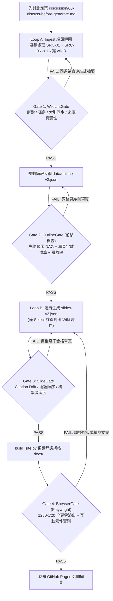

# 作業繳交內容整理

> **繳交標題格式提醒**（請將前方欄位替換為您的學校、學號、系級與姓名）：  
> `學校 學號 系級 姓名 Context Engineering：用 LLM Wiki 打造教學 HTML 簡報`

---

## 一、LLM Wiki 主題與簡短介紹

- **主題名稱**：**Context Engineering（上下文工程）**
- **簡短介紹**：  
  在多輪執行的 AI Agent 時代，「Prompt Engineering（如何寫好一句提問）」已經不夠；真正決定 AI 表現的關鍵，是如何管理每次推論當下輸入視窗裡的整個資訊集合（也就是 **Context Engineering**）。  
  本專案依循 Andrej Karpathy 提出的 **LLM Wiki 三層架構**（`raw/` 唯讀來源 → `wiki/` 編譯互連知識頁 → `index.md` / `log.md` / `SCHEMA.md`），並採取「**先討論、後生成**」的方式建構知識庫：
  1. 先於 [`discussion/00-discuss-before-generate.md`](https://github.com/MiuDog/taica-lab10-llm-wiki/blob/main/discussion/00-discuss-before-generate.md) 定調零基礎受眾、7 大分類、教學先修依賴圖（DAG）與可溯源規則。
  2. 實際 **Ingest 6 篇權威原始文獻**（高於至少 5 篇要求），涵蓋學術研究與業界工程實戰：
     - `[SRC-01]` Nelson F. Liu et al. (Stanford / UC Berkeley, TACL), *Lost in the Middle: How Language Models Use Long Contexts*
     - `[SRC-02]` Drew Breunig, *How Long Contexts Fail & How to Fix Your Context* (2025-06)
     - `[SRC-03]` Lance Martin / LangChain, *Context Engineering for Agents* (2025-07)
     - `[SRC-04]` Yichao "Peak" Ji / Manus, *Context Engineering for AI Agents: Lessons from Building Manus* (2025-07)
     - `[SRC-05]` Anthropic Engineering, *Effective Context Engineering for AI Agents* (2025-09)
     - `[SRC-06]` Andrej Karpathy, *LLM Wiki — Idea File* (2026-04)
  3. 編譯出 **16 篇原子化互連概念頁**（總計 83 條 `[[wikilink]]` 雙向連結、0 斷鏈、0 孤島、`index.md` 100% 同步），再以之作為唯一知識來源製作 14 頁互動式教學 HTML 簡報（100% 覆蓋全部 16 篇 Wiki 與 6 篇原始資料）。

---

## 二、成果與公開瀏覽連結

- **GitHub Public Repository（含 `raw/`、`wiki/`、`pipeline/`、`logs/`）**：  
  https://github.com/MiuDog/taica-lab10-llm-wiki
- **公開網站首頁（作品導覽入口）**：  
  https://miudog.github.io/taica-lab10-llm-wiki/
- **教學型 HTML 簡報（14 頁互動簡報＋Wiki 溯源抽屜）**：  
  https://miudog.github.io/taica-lab10-llm-wiki/slides.html
- **互動式 LLM Wiki 知識庫（含雙向反向連結與 Raw→Wiki→Slide 圖譜）**：  
  https://miudog.github.io/taica-lab10-llm-wiki/wiki.html
- **Loop / Graph 架構圖與反思專頁**：  
  https://miudog.github.io/taica-lab10-llm-wiki/workflow.html

---

## 三、Loop / Graph 流程圖與設計說明

本專案將整個生成流程設計為 **Loop A（知識編譯迴圈）** 與 **Loop B（教學簡報前移檢查狀態圖）** 兩個串接迴圈：

### 1. 資訊如何取得、整理、檢查與生成？
1. **取得與先討論**：透過 `discussion/` 確定目標為零基礎初學者，蒐集 6 篇唯讀文獻存入 `raw/`。
2. **整理編譯**：依 `SCHEMA.md` 將原始資料打散重組為 16 篇概念頁（含白話一句話與行內 `[SRC-XX]`），更新 `index.md` 與 `log.md`。
3. **檢查機制**：
   - `Gate 1 (WikiLintGate)` 檢查知識庫自身健康度。
   - `Gate 2 (OutlineGate)` 在寫作前就先鎖定「先修概念 DAG（必須先教 CPU/RAM 比喻才能教中間迷失與失效模式，先教失效才能教 WSCI 策略）」與單頁字數上限。
   - `Gate 3 (SlideGate)` 逐頁查核來源標註是否漂移、核心術語是否有 Wiki 根據、是否未解釋先用專有名詞。
   - `Gate 4 (BrowserVisualGate)` 實機用 Chromium 在 `1280×720` 與 `390×844` 檢查零溢出與所有互動元件。
4. **產生簡報與靜態網頁**：由 `pipeline/build_site.py` 將所有 Markdown、簡報 JSON 與審計報告編譯成 `docs/assets/wiki-data.js`，讓簡報每頁底部皆可直接點擊打開對應的 Wiki 溯源抽屜。

### 2. 哪些步驟會重複執行？哪些地方需要檢查或重新生成？為什麼這樣設計？
- **重複執行的步驟**：
  - **Ingest 迴圈**：對 `SRC-01`～`SRC-06` 重複執行 6 輪「讀 Raw → 跨頁寫入 Wiki → 同步 `index.md` 與 `log.md` → `WikiLint`」。
  - **單頁檢查與局部重寫迴圈**：任一張投影片在 `Gate 3` 或 `Gate 4` 不通過時，僅重寫或精簡該單頁（避免牽連其他頁）。
- **設計理由**：這套流程本身即實踐 **Context Engineering**——利用 `index.md` 做精準 **Select**、利用獨立檔案與大綱做 **Write**、把檢核拆成四支腳本做 **Isolate**，防止 AI 因為上下文過長產生 **Context Rot** 或幻覺。

---

## 四、一次實際執行的結果與檢查紀錄

我們實際執行了兩輪完整管線並保存機器審計報告（位於 repo 的 `logs/` 目錄）：

| 執行輪次 | Gate 1 (WikiLint) | Gate 2 (OutlineGate) | Gate 3 (SlideGate) | Gate 4 (BrowserGate) | 總結果 |
| :--- | :--- | :--- | :--- | :--- | :--- |
| **Run #1 (`v1` 初版線性流程)** | PASS (0 錯) | 未啟用 (v1 缺失) | **FAIL (5 項缺陷)** | **FAIL (1 項溢出)** | **FAIL (共 6 項問題)** |
| **Run #2 (`v2` 前移檢查狀態圖)** | **PASS (0 錯)** | **PASS (0 錯)** | **PASS (0 錯)** | **PASS (0 錯)** | **ALL PASS (0 問題)** |

- **Run #1 (v1) 實際抓到的缺陷紀錄**（[`logs/run-01-v1-audit.md`](https://github.com/MiuDog/taica-lab10-llm-wiki/blob/main/logs/run-01-v1-audit.md)）：
  1. `G3-JARGON-ORDER` (`slide-1`, `slide-2`)：初學者還沒學過定義前，第 1～2 頁就提前出現未解釋術語 `LLM Wiki`、`Compaction`、`KV-Cache`。
  2. `G3-BEGINNER-DENSITY` (`slide-3`)：單頁硬塞 765 字與 7 個要點，超過 420 字 / 5 要點負荷上限。
  3. `G3-SOURCE-CONSISTENCY` (`slide-4`)：發生 **Citation Drift**（標註了 `[SRC-04]`，但該頁引用的 `context-failure-modes` 只含 `SRC-02` 與 `SRC-05`）。
  4. `B4-SLIDES-1280X720` (`S3`)：Playwright 實機在 `1280×720` 偵測到第 3 頁 `.slide-body` 垂直溢出（`body 469px > client 413px`）。
- **Run #2 (v2) 驗證通過紀錄**（[`logs/run-02-v2-audit.md`](https://github.com/MiuDog/taica-lab10-llm-wiki/blob/main/logs/run-02-v2-audit.md)）：
  - 經重構為 14 頁定稿並通過全數 4 道關卡；Playwright 實測 `1280×720` 全 14 頁皆 `body 413/413` 零溢出、互動元件（書桌模擬器、U 型曲線、失效診斷卡、3 題小測驗、Wiki 溯源抽屜、Knowledge Graph）與 `390×844` 行動端 RWD 全數正常，0 Console/JS Errors。

---

## 五、反思（回答作業步驟四）

1. **哪一個節點最常出錯？**  
   **「簡報正文生成節點（DraftSlides）」**最常出錯。當沒有前置結構約束直接叫 AI 寫投影片時，最容易同時踩中三個坑：**單頁文字太擠導致瀏覽器溢出**、**未先定義就直接拋出專有名詞**、以及**把不同來源編號混標進同一頁（Citation Drift）**。
2. **發現問題後，把檢查往前移到了哪一個步驟？**  
   我把原本事後才人工檢查的負擔，大幅往前移到兩個位置：
   - **Knowledge Layer（`Gate 1: WikiLintGate`）**：在生成任何簡報之前，就先確保 `wiki/` 零斷鏈、零孤島且與 `raw/` 來源一致，防止上游知識庫夾帶錯誤（避免 Context Poisoning）。
   - **Pre-Generation Outline（`Gate 2: OutlineGate`）**：在 AI 開始寫第一句投影片內文之前，就先驗證 `outline-v2.json` 的**先修概念依賴順序（DAG）**、**單頁字數上限**與**100% 覆蓋率**。
3. **有沒有因此修改 Workflow / Graph？為什麼？**  
   **有**。我們從 v1 的「討論 → 一次全頁生成 → 事後發現問題全部重寫」的**單向線性流程**，修改為 v2 的「**帶前移攔截關卡（OutlineGate）＋逐頁獨立檢查（SlideGate）＋實機視覺確認（BrowserGate）＋局部失敗重試邊緣**」的**狀態圖（State Graph）**。  
   修改後，大綱順序問題在寫內文前就被擋下；寫作階段若有單頁超標也只需局部重寫那一頁，不會牽連整份簡報，最終讓 Run #2 一次通過所有機器檢查與實機瀏覽器驗證。
